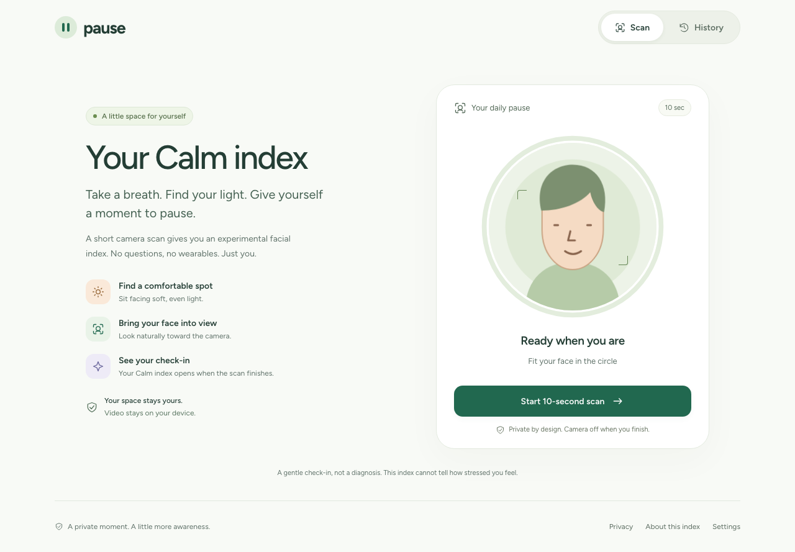

# Pause

**A private moment. A little more awareness.**

A browser-based facial check-in with a light interface, a short camera scan, and an experimental **Calm index** from 0 to 10. Video processing stays on your device.

[Live site](https://jyotiraditya21-bug.github.io/pause-stress-mvp/) · [Get started](#get-started) · [How it works](#how-it-works) · [Documentation](#documentation)



> The Calm index is an experimental facial geometry index. It is not a medical or psychological measurement and cannot tell how stressed someone feels. Real labeled-dataset accuracy and participant repeatability have **not been established**.

## Branch status

The live site deploys from `main` after browser and offline checks pass. The provisional tolerant acquisition policy remains opt-in; deployment does not enable it by default.

See the [release-readiness record](docs/RELEASE_READINESS.md) for implemented safeguards, actual checks and remaining validation requirements.

## The experience

- Start a short scan with explicit camera permission.
- Follow the circular preview and simple framing guidance.
- See your index, within-scan range, signal quality, and time graph.
- Save selected results in this browser and review their trend.
- Optionally calibrate when calm for a personal reference; reset it in Settings.

The interface uses responsive layouts, accessible focus states, gentle motion, and a reduced-motion alternative. The PWA can initialize a scan offline after its app and model assets have been cached.

Standard mode captures a fixed ten seconds after positioning; rejected frames and dropped frames stay missing on the actual capture clock. Camera/model setup takes additional time, with a 25-second cap after initialization if positioning or capture cannot finish. Experimental tolerant mode is visibly labeled and may extend capture to twenty seconds.

History separates algorithms, acquisition versions, and personal-baseline identities instead of connecting incompatible results. Damaged records are skipped safely; explicit recovery backs up the original data in this browser before retaining valid scans. Recovery backups can be removed separately in Settings. Older personalized scans without baseline identity remain separate.

## Get started

Use **Node.js 22** and npm. Camera access requires localhost or HTTPS.

```sh
git clone https://github.com/Jyotiraditya21-bug/pause-stress-mvp.git
cd pause-stress-mvp
cd frontend
npm ci
npm run dev
```

Open [localhost:5173](http://127.0.0.1:5173/). No backend, API key, account, or GPU is required for the browser scan.

For a production preview:

```sh
npm run build
npm run preview
```

## How it works

```text
Camera frames → MediaPipe landmarks → Acquisition checks
              → Fixed geometry formula → Time-window consensus
              → Calm index, range and signal quality
```

MediaPipe is the pretrained computer-vision component. The index itself uses a fixed mathematical formula; we did not train a stress predictor for the live application. Higher values mean less tension-like geometry relative to the selected reference, not a measured psychological state.

| Mode | Reference | Features |
| --- | --- | --- |
| Generic, default | Fixed canonical face | Brow furrow, lip press, lip corner |
| Personal baseline | Optional calm scan; feature median/MAD | The three generic features plus jaw geometry |
| Tolerant experiment, opt-in | Original four-feature canonical formula or personal baseline | Soft acquisition weights, individual feature masks, smoothing, 10–20 second capture |
| Neural model experiment, enabled by default | MobileNetV3-Small ONNX model (74.25% val bal acc) | 224×224 normalized face crop inference, EMA smoothing ($\alpha=0.20$), 100% on-device WebAssembly |

Personal baselines expire after 30 days and are versioned. The tolerant experiment is available at [`?tolerance=1`](http://127.0.0.1:5173/?tolerance=1); it remains off by default until its fixed evaluation criteria pass. Optional 3-D frontalization is also off. See [the tolerance protocol](docs/TOLERANCE.md). The experimental neural model is enabled by default and can be turned off in Settings; saved choices are respected. It can also be explicitly enabled via [`?ml=1`](http://127.0.0.1:5173/?ml=1). It runs completely on-device in WebAssembly with zero server uploads, evaluating face crops alongside the geometric index for research comparison.

No rejected scan receives a guessed number. Range and confidence describe acquisition consistency; they are not clinical certainty.

## Privacy

- No video, audio, or landmarks are recorded, uploaded, or persisted by the normal browser flow.
- Camera resources are released on finish, cancel, error, navigation, and page hide.
- Saved results and optional baselines stay in the current browser profile.
- Monitoring is disabled unless configured. Enabled events must exclude scores, video, and landmarks.
- Dataset recordings, research caches, secrets, and databases are excluded from Git.

The historical backend and explicit research recording tools have separate behavior. They are not part of the deployed scan.

## Development and checks

Run from `frontend/`:

```sh
npm test                       # Fast unit tests
npm run build                 # Production build and PWA assets
npx playwright install chromium webkit
npm run test:e2e              # Browser flows, accessibility, responsive checks
npm run test:webkit           # Safari-engine UI regressions, not real iPhone camera validation
npm run test:offline          # Production-only offline test
npm run test:lighthouse       # Local mobile audit
```

Release checks cover capture-clock gaps, calibration navigation, damaged-storage recovery, reference-separated trends, camera cleanup, accessibility, small screens and offline model initialization. JavaScript/Python parity includes rejected and dropped capture frames within `1e-6`. These software checks do not establish prediction accuracy or human repeatability; real Safari/iPhone camera validation remains a manual check.

The historical API is deliberately local-only, including client/Host/Origin checks, 64 KiB request limits, per-process rate limits, bounded session pagination and explicit SQLite connection cleanup. It has no accounts or multi-user ownership and must not be placed behind a public reverse proxy. Public multi-user backend hosting requires separate authentication, ownership and deployment work; it is not needed for this static product. Run its isolated tests with:

```sh
cd backend
python3 -m venv .venv
.venv/bin/python -m pip install -r requirements-test.txt
.venv/bin/python -m unittest discover -s . -p 'test_*.py' -v
```

For offline research, use Python 3.11 or 3.12 from the repository root:

```sh
python3.12 -m venv stress_math/.venv
stress_math/.venv/bin/python -m pip install -r stress_math/requirements-core.txt
stress_math/.venv/bin/python -m unittest discover -s . -p 'test_*.py' -v
```

Optional pretrained comparators need additional dependencies; see [the research guide](stress_math/README.md). No training is required by the fixed scoring methods.

## Project structure

```text
frontend/       React + Vite application, camera flow, PWA and browser tests
stress_math/    Python mirrors, offline evaluation and optional comparators
backend/        Historical FastAPI/SQLite prototype; unused by the web scan
training/       Historical deferred training experiments
docs/           Deployment, tolerance protocol, validation roadmap and archive
.github/        CI, Pages deployment and contribution templates
```

## Documentation

| Guide | Purpose |
| --- | --- |
| [Deployment](docs/DEPLOY.md) | GitHub Pages, Cloudflare Pages and configuration |
| [Tolerance protocol](docs/TOLERANCE.md) | Fixed weights, result tiers, manifests and adoption rules |
| [Validation roadmap](docs/VALIDATION_TODO.md) | Evidence still needed before accuracy claims |
| [Research tools](stress_math/README.md) | Mathematical, heuristic, pulse and pretrained comparisons |
| [Task history](TASKS.md) | Completed work, checks and outstanding tasks |
| [Contributing](.github/CONTRIBUTING.md) | Local workflow and review expectations |
| [Security](.github/SECURITY.md) | Reporting vulnerabilities without exposing camera data |
| [Historical summary](summary.MD) | Earlier design snapshot; current guides take precedence |
| [Archive](docs/archive/README.md) | Earlier MVP instructions and screenshots |

## Deployment

GitHub Pages deploys `frontend/dist` from `main`. Use `VITE_BASE=/pause-stress-mvp/` and `VITE_STORAGE_MODE=browser`; Cloudflare uses `VITE_BASE=/`. Optional monitoring variables are documented in [frontend/.env.example](frontend/.env.example). Do not deploy the historical FastAPI backend as part of this scan.

## Licensing

Third-party notices are preserved with their assets, including [MediaPipe notices](frontend/public/LICENSE.mediapipe). No project-wide license has been declared. Do not assume a permissive license for the application or optional model weights; [model licensing review remains pending](docs/VALIDATION_TODO.md).

### Scan reporting limitations

New standard scan results distinguish valid processed observations from time-slot occupancy. Counts exclude the first settling second and do not represent every camera frame. The displayed within-scan variation is robust dispersion, not a confidence interval or a between-session reliability estimate. Full observed window range and recorded consensus exclusions remain visible. Older results without these denominator fields are labeled unavailable; saved scores are not recomputed. Acceptance rules remain experimental; see [the consensus review](training/CONSENSUS_REVIEW.md).

### Prospective acquisition study (local, opt-in)

The default policy is preserved. The unvalidated candidate is available locally at `/?policy=prospective-1&tolerance=0&diagnostics=1&ml=1&study=1`. Its frozen engineering rules reject sparse-validity and terminal-change cases; they do not establish stress accuracy. See [the frozen policy](training/PROSPECTIVE_POLICY.md). Candidate records use a separate acquisition version in History.

The guided panel requires an explicit **Begin new pair and save derived outcomes locally** action. This saves derived outcomes, including failures, to this browser; it never records/uploads camera media. Choose a pseudonym/task and obtain each participant's consent. Complete scan A, wait for the7-minute target (permitted interval5–10minutes), then complete scan B. Do not navigate away during capture. Off-protocol outcomes remain in the log. Reloading resumes the saved timer from timestamps. Download the derived study log after collection and keep it outside Git.

```sh
# Run from the repository root; install stress_math requirements in a virtual environment.
python -m unittest stress_math.test_prospective_mirror stress_math.test_prospective_study
python -m stress_math.evaluate_prospective_study /private/path/pause-local-study.json --output /private/path/new-study-report
# With separately consented matched-clip nuisance scores:
python -m stress_math.evaluate_prospective_study /private/path/pause-local-study.json --nuisance /private/path/nuisance.json --output /private/path/new-complete-report
```

The report generator checks both task AUCs, condition-specific repeatability, acceptance coverage and all six nuisance conditions. Undefined or insufficient evidence cannot PASS. It rejects mixed policy fingerprints and never fits model weights or thresholds. Logs are task-based labels, not clinical stress ground truth. Additional participants and controlled nuisance clips are required; one person's informal repeats do not validate this candidate.
